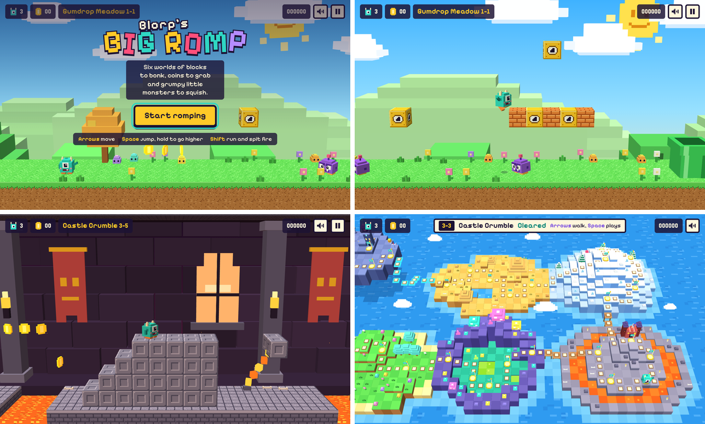

# Blorp's Big Romp

A colorful voxel platformer with a 2.5D side-scrolling view, built with [three.js](https://threejs.org/). You play Blorp, a one-eyed teal monster, through six worlds and thirty levels of blocks to bonk, coins to grab and grumpy little monsters to squish. Between levels Blorp walks a 3D map of his world, where any level already opened can be played again. There is no time limit.

**[Play it in your browser](https://glennbacon.github.io/blorps-big-romp/)**



It is also one of the games in [Glenn Bacon's arcade](https://glennbacon.github.io/arcade/), next to its sequel, [Blorp's Big Romp 2](https://github.com/glennbacon/blorps-big-romp2).

The whole game is one HTML file. There are no image or sound files: every model is built in code from boxes, every texture is drawn on a 16×16 canvas, and all music and sound effects are synthesized with the Web Audio API.

## Play

Play online at <https://glennbacon.github.io/blorps-big-romp/>, or in the [arcade](https://glennbacon.github.io/arcade/blorps-big-romp/).

To run it from a copy of this repository, open `index.html` in a current version of Chrome, Safari, Firefox or Edge. Nothing needs installing. An internet connection is needed either way because three.js and the fonts load from CDNs.

## Controls

In a level:

| Action | Keyboard | Touch |
| --- | --- | --- |
| Move | Arrow keys or A / D | Arrow pads |
| Jump (hold to go higher) | Space, Up, W or Z | A |
| Run, and spit fire in fire form | Shift or X | B |
| Pause | P or Esc | Pause button |
| Sound on/off | M | Sound button |

On the map:

| Action | Keyboard | Touch |
| --- | --- | --- |
| Walk along the path | Arrow keys or W A S D | Four-way pad |
| Walk faster | Shift or X | B |
| Play the level Blorp stands on | Space, Enter, Z or K | A |
| Sound on/off | M | Sound button |

On a phone held upright the game sits above a handheld-style control deck. In landscape the controls float over the bottom corners, and in a level the view rides up so the ground Blorp walks on stays above them. Pressing between A and B presses both. On the map the two arrows become a four-way pad.

## What's in the game

**The map**

Blorp's world is a group of voxel islands seen from above: the meadow's green hills, the grotto sunk in purple rock, a castle rock in a moat of lava, a snowy mountain, the dunes with their pyramids, and a citadel floating over the sea at the top of a stair of light. A path runs from level to level across all of it.

- Blorp stands on a level's marker. Press a direction the path leaves by and he hops along it to the next marker, turning corners by himself. Holding the direction carries him on through markers while the path keeps going that way.
- Grey markers with a padlock are not open yet. The bright one is the furthest level opened. Gold markers with a flag are cleared.
- Clearing a level for the first time makes the next stretch of path appear and opens the marker at its end.
- Any opened level can be played again, as often as you like, and Blorp keeps his lives, coins, score and power-up from one level to the next.
- The clear screen, game over and the win screen all lead back to the map, and the pause screen has **Back to the map**.

**Worlds**

Each world has five levels, and each level has its own sky and light.

1. **Gumdrop Meadow**: open grassland that introduces blocks, stomping, shells, springs and cloud ledges.
2. **Glowshroom Grotto**: a cave with goo pits, moving ledges and a low roof, which opens up at the flag.
3. **Castle Crumble**: lava, spinning ember chains and a first fight with King Grump, who gets away.
4. **Snowcone Summit**: slippery ice, and icicles that drop when Blorp walks under them.
5. **Dumpling Dunes**: quicksand, pyramids, and Prickles that lob seeds.
6. **Comet Citadel**: low gravity, so Blorp jumps higher and floats further, and King Grump again at the end.

**Blocks and pickups**

- Bricks smash once Blorp is big.
- Blinking eye-blocks hold coins and power-ups. A few blocks are hidden.
- Muffin makes Blorp big, chili gives fire spit, star jelly makes Blorp invincible for ten seconds, a heart is an extra life.
- 100 coins also give a life.

**Monsters**

- Grumblobs, hopping Boings and flying Battys can be stomped.
- Shellbys leave a shell that can be kicked into other monsters.
- Spikits, pipe Chompers and Prickles cannot be stomped. Use fire, a shell or a star. A Prickle standing on bricks can also be bonked from below.
- Icicles cannot be stomped either. Keep moving and they land behind you.
- King Grump takes three stomps in Castle Crumble and five in Comet Citadel.

**Also:** springshrooms, one-way ledges, moving platforms and a checkpoint in each level.

**Saved progress**

The game remembers how far the path is open and which marker Blorp stands on, with your score, coins, lives and power-up, in the browser's local storage. Next time, the title screen offers **Continue** at that marker and puts Blorp back on the map there; **New game** starts over with only the first level open. Game over resets the score, coins, lives and power-up but not the map. Finishing the game keeps the save, with every level open. A save from before the map existed still works: everything up to the level it had reached is open. If the browser blocks storage, the game still plays but forgets where you were.

## Physics

Walking, running, skidding and jumping use the NES Super Mario Bros. speeds and gravities, converted from pixels per frame to tiles per second. Jump height depends on how long the button is held and on how fast Blorp is moving at takeoff. Two deliberate departures: the jump is slightly stronger (about 4.2 tiles standing, 5 running), and there is a little jump buffering and ledge forgiveness so touch controls feel fair.

The simulation runs at a fixed 120 steps per second, independent of frame rate.

## Project layout

| Path | What it holds |
| --- | --- |
| `index.html` | The built, playable game |
| `src/head.html` | Page markup, styles, HUD, screens and touch deck |
| `src/a_art.js` | Voxel geometry builder, pixel textures and every model |
| `src/b_levels.js` | Tile types, the level builder, the thirty levels and the list of worlds |
| `src/c_audio.js` | Sound effects and the step-sequencer music |
| `src/d_world.js` | Renderer, themes, terrain mesher, scenery, effects and camera |
| `src/e_play.js` | Player physics, blocks, power-ups, monsters and the boss |
| `src/f_map.js` | The world map's island, its route, and the rules of what is open and of walking |
| `src/g_mapview.js` | Drawing the world map: terrain, sea, markers, path, Blorp and the camera |
| `src/h_flow.js` | Level loading, animation, screens, the flow between map and levels, input and the main loop |
| `src/tail.html` | Closing markup |
| `build.sh` | Joins the pieces in `src/` into `index.html` |
| `screenshot.png` | The picture at the top of this page |
| `tools/check-levels.js` | Proves that every level can be finished |
| `tools/check-map.js` | Proves the world map is sound and that its rules hold |
| `tools/check-save.js` | Checks that progress is saved and offered back as Continue |
| `tools/game.js` | Loads the game code into Node for the checks |

## Build

```bash
./build.sh
```

This needs only bash. If Node.js is installed, the script also checks the game script for syntax errors.

## Checks

```bash
node tools/check-levels.js          # every level, about two minutes
node tools/check-levels.js 4-2      # one level
node tools/check-levels.js --map 4-2  # print a level as text
node tools/check-map.js             # the world map: its route, walking, opening levels, controls
node tools/check-map.js --map       # print the island as text
node tools/check-save.js            # saved progress and Continue
```

These need Node.js and nothing else. The level check loads the game code from `src/` with the 3D and page layers stubbed out, then has a search bot play each level with the real rules until it reaches the flag or beats the boss. Each level is played as small Blorp and as big Blorp, and the bot jumps 5% lower than a player can. It also reports common slips, such as a monster placed in mid-air, a roof low enough to hit when jumping for the flag, or a tree standing in front of the checkpoint flag or inside the hut after the goal. Run it after editing a level.

The map check loads the game the same way and checks the island and the route (one marker per level, a path that moves one cell at a time, never climbs more than one step, never crosses or runs alongside itself, and is never hidden from the camera by the ground), then drives the real walking rules, the flow between map and levels, and the map's keys and touch pad. Run it after editing the map.

The save check starts the game the way a page load does, with a stand-in for the browser's storage, and checks what is saved at each point and what the title screen offers afterwards.

## Editing levels

Levels are written with a small builder in `src/b_levels.js`. Each level is a function, and the `WORLDS` list at the end of the file puts them in order. Coordinates are in tiles, with the walking surface at `y = 2`.

```js
B.ground(0, 44)               // ground from column 0 to 44
 .row(21, 5, 'B?BMB')         // a row of blocks starting at column 21, height 5
 .pipe(31, 2)                 // a pipe two tiles tall; pass true to add a Chomper
 .enemy('blob', 27)           // a monster standing on the ground at column 27
 .plat(31, 2, 3, 'x', 3, 1.3) // a moving ledge
 .ice(16, 24)                 // turn the ground from column 16 to 24 into ice
 .spring(60)
 .checkpoint(93)
 .goal(194);                  // the flag; a boss level uses .boss(x, left, right, hitPoints) instead
```

Characters for `row`:

| Char | Tile | Char | Tile |
| --- | --- | --- | --- |
| `B` | Brick | `m` | Brick holding many coins |
| `?` | Coin block | `s` | Brick holding a star |
| `M` | Power-up block | `I` | Hidden block with a life |
| `S` | Star block | `i` | Hidden block with a coin |
| `L` | Life block | `H` | Hard block |
| `=` | One-way ledge | `C` | Coin |
| `^` | Spikes | `#` | Ice |

Monster types are `blob`, `shellby`, `spikit`, `batty`, `boing`, `chomper`, `prickle` and `icicle`. An icicle needs a solid tile directly above it.

For poking at a running game, the browser console has a `__romp` object with helpers such as `__romp.load(7)` to jump to a level (levels count from 0, so 7 is level 2-3) and `__romp.tp(x, y)` to move Blorp.

## Editing the map

The island is painted in `buildIsle` in `src/f_map.js` with a small builder, in cells, with north at the top. Heights are in steps of half a tile.

```js
B.blob(9.5, 22.5, 8.6, 6, 0, 2)   // an ellipse of land: middle, radii, world (0 to 5), height
 .raise(8.5, 19.8, 3.6, 3, 0.7)   // a hill on land that is already there: middle, radius, extra height, roundness
 .flat(23.5, 22.3, 4.4, 3.7, 1)   // level an area
 .pool(23.2, 22, 1.3, 0.9, MK_GOO) // turn land into lava, goo or water
 .lift(5.5, 6.5, 6, 6, 7)         // make land float, its underside at this height
 .tidy()                          // smooth the coast
 .route(3, 25, ['EEENN', 'NNN'])  // where the path starts, then compass moves from each marker to the next
```

The route's heights are worked out from the land it crosses: it cuts and fills by halves so that no step is more than one high, and it bridges sea, lava and thin air by itself. The scenery is placed in `mapViewBuild` in `src/g_mapview.js`.

On the map, `__romp.open(30)` opens every level, `__romp.at(12)` stands Blorp on a marker, and `__romp.zoom(2.3)` pulls the camera back far enough to see the whole island.

## Credits

- [three.js](https://github.com/mrdoob/three.js) r128, MIT license, loaded from cdnjs.
- [Pixelify Sans](https://fonts.google.com/specimen/Pixelify+Sans), SIL Open Font License, loaded from Google Fonts.
- [Jersey 20](https://fonts.google.com/specimen/Jersey+20), SIL Open Font License, loaded from Google Fonts. It is used for the digits only: at small sizes Pixelify Sans's 2 and 5 are hard to tell from an 8.

The characters, levels, art and music are original to this project.

## License

[MIT](LICENSE)
